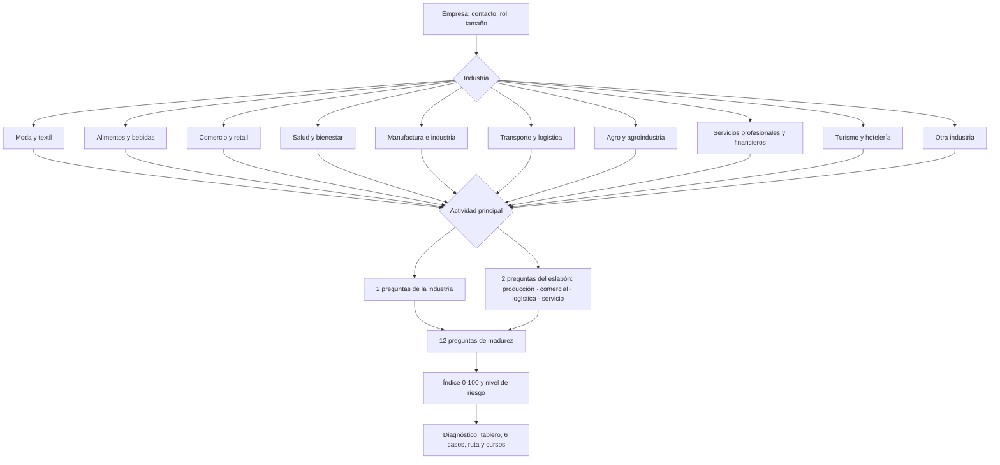

# Esquema de la encuesta · Radar IA

> Documento generado automáticamente desde el código (`npm run esquema`). Si cambia una pregunta en
> `public/js/motor/`, vuelva a generarlo.

## 1. Resumen

- **21 preguntas** por empresa, una por pantalla (≈ 5 minutos, unos 14 segundos por pregunta).
- **5 de perfil** (no puntúan), **4 del nicho** (dependen de la industria y la actividad) y **12 de madurez** (iguales para todas las empresas).
- **15 preguntas puntúan** de 0 a 3 y alimentan el índice de madurez (0–100). Una más (objetivos) no puntúa: sirve para priorizar casos.
- **10 industrias × 4 actividades = 40 nichos.** Cada actividad pertenece a uno de los 4 eslabones de la cadena de valor.

### Orden de las secciones

| # | Sección | Preguntas | ¿Puntúa? | Qué decide |
|---|---|---|---|---|
| 1 | Empresa | 3 | No | Nombre (aparece en el diagnóstico), rol y tamaño (escala de los datos sintéticos) |
| 2 | Sector | 2 | No | La industria y la actividad definen las preguntas del nicho y los casos |
| 3 | Su negocio | 4 | Sí · dimensión «Negocio» | 2 preguntas de la industria + 2 del eslabón de la actividad |
| 4 | Datos | 3 | Sí · «Datos» | Registro, histórico y calidad |
| 5 | Tecnología | 2 | Sí · «Tecnología» | Almacenamiento e integración |
| 6 | Analítica | 3 | Sí · «Analítica» | Decisiones, reportes y uso de IA |
| 7 | Equipo | 2 | Sí · «Talento» | Responsable y habilidades |
| 8 | Estrategia | 2 | 1 sí · 1 no | Presupuesto (puntúa) y objetivos (prioriza casos) |

### Flujo adaptativo

## 2. Cómo se distribuye el puntaje

Cada respuesta vale de 0 a 3 puntos. Por dimensión se promedia y se lleva a 0–100; el índice es el promedio ponderado de las dimensiones.

| Dimensión | Peso | Preguntas | Peso de cada pregunta en el índice |
|---|---|---|---|
| Prácticas del negocio | 15 % | 4 | 3,8 % |
| Datos: disponibilidad y calidad | 25 % | 3 | 8,3 % |
| Tecnología e integración | 15 % | 2 | 7,5 % |
| Uso analítico actual | 20 % | 3 | 6,7 % |
| Talento y cultura de datos | 15 % | 2 | 7,5 % |
| Estrategia e inversión | 10 % | 1 | 10,0 % |

**Fórmula:** `índice = Σ (puntaje de la dimensión × peso)`, donde `puntaje de la dimensión = suma de puntos ÷ (3 × preguntas) × 100`.

Pasar una pregunta de 0 a 3 puntos sube el índice en su peso por pregunta. La que más pesa sola es la de **estrategia** (10,0 %); le siguen las de **datos** (8,3 % cada una). Las del nicho son las que menos pesan individualmente (3,8 %).

### Niveles de riesgo

| Nivel | Índice | Lectura | Enfoque |
|---|---|---|---|
| ● Riesgo alto | 0 – 34 | Sin bases de datos para decidir | Fundamentos y construcción de la base de datos |
| ◆ Riesgo moderado | 35 – 61 | En transición analítica | Integración, tableros e indicadores |
| ▲ Riesgo bajo | 62 – 100 | Lista para escalar con IA | Modelos predictivos e IA aplicada |

**Reglas de coherencia** (se aplican después del índice):

- Si la dimensión **Datos** es menor a 30, el nivel es **riesgo alto** sin importar el resto.
- Si **Datos** es menor a 55, la empresa **no puede quedar en riesgo bajo** (pasa a moderado).
- Toda respuesta con 0 puntos es un hallazgo **crítico**; con 1 punto, **mejorable**. Aparecen ordenados por gravedad y peso.

### Ejemplo: Panadería Carlitos

Microempresa de alimentos, actividad «Producción y transformación», que anota todo en cuadernos.

| Dimensión | Puntaje | Peso | Aporte al índice |
|---|---|---|---|
| Negocio | 17 | 15 % | 2,5 |
| Datos | 11 | 25 % | 2,8 |
| Tecnología | 0 | 15 % | 0,0 |
| Analítica | 22 | 20 % | 4,4 |
| Talento | 17 | 15 % | 2,5 |
| Estrategia | 33 | 10 % | 3,3 |

**Índice: 16/100 → Riesgo alto.** 15 hallazgos (8 críticos).

## 3. Preguntas de perfil (no puntúan)

### Cuéntenos de su empresa

Formulario: nombre de la empresa (obligatorio), nombre de contacto, correo, teléfono/WhatsApp, ciudad y autorización de tratamiento de datos (Ley 1581 de 2012, obligatoria).

*Nota para el consultor:* Confirme la autorización de tratamiento de datos antes de continuar.

### ¿Cuál es su rol en la empresa?

| Opción | Respuesta |
|---|---|
| A | Dueño o gerente general |
| B | Director o jefe de área |
| C | Analista, coordinador o profesional |
| D | Sistemas o tecnología |
| E | Otro |

### ¿Cuántas personas trabajan en la empresa?

| Opción | Respuesta |
|---|---|
| A | 1 a 10 (Microempresa) |
| B | 11 a 50 (Pequeña) |
| C | 51 a 200 (Mediana) |
| D | Más de 200 (Grande) |

### ¿En qué industria está su empresa?

Tarjetas con las 10 industrias (ver sección 4).

*Nota para el consultor:* La industria define las preguntas específicas y los casos que verá el cliente.

### ¿Cuál es su actividad principal dentro de la industria?

Tarjetas con las 4 actividades de la industria elegida (ver sección 4).

*Nota para el consultor:* Ejemplo: en moda, quien compra y vende ropa (no la produce) es «Compra y venta de ropa».

## 4. Preguntas del nicho

Después de elegir la actividad aparecen 4 preguntas: **2 propias de la industria** y **2 del eslabón** al que pertenece la actividad. Todas puntúan en la dimensión «Negocio».

### 4.1 Industrias, actividades y eslabón

| Industria | Actividad | Descripción | Eslabón |
|---|---|---|---|
| 👗 Moda y textil | Diseño y confección | Producimos las prendas (taller o planta propia o maquila) | Producción / transformación |
|  | Compra y venta de ropa | Compramos a proveedores y vendemos; no producimos | Comercialización y ventas |
|  | Marca o tienda online | Vendemos principalmente por redes y e-commerce | Comercialización y ventas |
|  | Distribución mayorista | Llevamos producto a tiendas y almacenes | Logística y distribución |
| 🥐 Alimentos y bebidas | Producción y transformación | Panadería, pastelería, planta de alimentos o bebidas | Producción / transformación |
|  | Restaurante o cafetería | Preparamos y servimos a la mesa o para llevar | Servicio y atención al cliente |
|  | Punto de venta de alimentos | Vendemos alimentos que compramos o producimos | Comercialización y ventas |
|  | Distribución y domicilios | Llevamos producto a tiendas, empresas u hogares | Logística y distribución |
| 🛒 Comercio y retail | Tienda física | Una o varias tiendas de venta al detal | Comercialización y ventas |
|  | Comercio electrónico | Vendemos principalmente en línea | Comercialización y ventas |
|  | Bodega y distribución mayorista | Abastecemos a otros comercios | Logística y distribución |
|  | Atención y posventa | Garantías, servicio técnico, fidelización | Servicio y atención al cliente |
| 🩺 Salud y bienestar | IPS, clínica o consultorio | Prestamos servicios médicos u odontológicos | Servicio y atención al cliente |
|  | Farmacia o droguería | Vendemos medicamentos y productos de salud | Comercialización y ventas |
|  | Laboratorio | Toma y procesamiento de muestras o producción | Producción / transformación |
|  | Estética y bienestar | Spa, gimnasio, centro de estética | Servicio y atención al cliente |
| 🏭 Manufactura e industria | Producción en planta | Fabricamos productos en línea o por lotes | Producción / transformación |
|  | Compras y abastecimiento | Materias primas, proveedores e inventarios | Logística y distribución |
|  | Venta a empresas (B2B) | Comercializamos a distribuidores o industrias | Comercialización y ventas |
|  | Mantenimiento y posventa | Servicio técnico, garantías, repuestos | Servicio y atención al cliente |
| 🚚 Transporte y logística | Transporte de carga | Movemos mercancía entre ciudades o regiones | Logística y distribución |
|  | Mensajería y última milla | Entregas urbanas a hogares o comercios | Logística y distribución |
|  | Almacenamiento y bodegaje | Operamos bodegas o centros de distribución | Logística y distribución |
|  | Agencia u operador logístico | Coordinamos y vendemos servicios logísticos | Comercialización y ventas |
| 🌱 Agro y agroindustria | Producción primaria | Cultivo, cría o producción en finca | Producción / transformación |
|  | Transformación agroindustrial | Procesamos lo que se cosecha (café, lácteos, pulpas) | Producción / transformación |
|  | Comercialización y exportación | Compramos y vendemos producto agrícola | Comercialización y ventas |
|  | Acopio y distribución | Recogemos, almacenamos y transportamos | Logística y distribución |
| 💼 Servicios profesionales y financieros | Consultoría y asesoría | Contable, jurídica, empresarial | Servicio y atención al cliente |
|  | Servicios financieros | Crédito, seguros, cooperativas, fondos | Comercialización y ventas |
|  | Tecnología y software | Desarrollo, soporte, servicios TI | Servicio y atención al cliente |
|  | Educación y formación | Cursos, colegios, academias | Servicio y atención al cliente |
| 🏨 Turismo y hotelería | Hotel o alojamiento | Hotel, hostal, glamping, apartamentos | Servicio y atención al cliente |
|  | Agencia de viajes u operador | Vendemos planes y paquetes | Comercialización y ventas |
|  | Eventos y convenciones | Organizamos eventos o alquilamos espacios | Servicio y atención al cliente |
|  | Transporte turístico | Traslados, tours, excursiones | Logística y distribución |
| 🧭 Otra industria | Producción u operación | Fabricamos, construimos o ejecutamos | Producción / transformación |
|  | Comercialización | Vendemos productos o servicios | Comercialización y ventas |
|  | Logística | Movemos, almacenamos o distribuimos | Logística y distribución |
|  | Servicio al cliente | Atendemos y damos soporte | Servicio y atención al cliente |

Distribución de los 40 nichos por eslabón: Producción / transformación **7** · Comercialización y ventas **12** · Logística y distribución **10** · Servicio y atención al cliente **11**.

### 4.2 Preguntas por industria

#### 👗 Moda y textil

**¿Registran las ventas por referencia, talla y color?**

| Opción | Respuesta | Puntos |
|---|---|---|
| A | No, solo el total vendido | 0 |
| B | Por referencia, sin talla ni color | 1 |
| C | Sí, pero en archivos separados | 2 |
| D | Sí, en un sistema con todo el detalle | 3 |

*Nota para el consultor:* Pida un ejemplo: «¿sabe cuántas camisas talla M azules vendió el mes pasado?»

*Hallazgo si responde A o B:* Sin ventas por talla y color, las compras de temporada se hacen a ciegas y el inventario termina en liquidación.

**¿Cómo deciden cuánto producir o comprar para cada temporada?**

| Opción | Respuesta | Puntos |
|---|---|---|
| A | Por intuición o lo que dice el proveedor | 0 |
| B | Repetimos lo de la temporada anterior | 1 |
| C | Analizamos ventas pasadas en Excel | 2 |
| D | Con un pronóstico por referencia | 3 |

*Hallazgo si responde A o B:* La compra o producción de temporada no se apoya en datos históricos: alto riesgo de faltantes y sobrestock.

#### 🥐 Alimentos y bebidas

**¿Registran cuánto producto sobra, se daña o se bota cada día?**

| Opción | Respuesta | Puntos |
|---|---|---|
| A | No lo registramos | 0 |
| B | Lo calculamos «a ojo» | 1 |
| C | En una planilla, por producto | 2 |
| D | En el sistema, por producto y día | 3 |

*Nota para el consultor:* La merma es el dato que más rápido muestra el valor de medir. Si no la conocen, pídales un estimado.

*Hallazgo si responde A o B:* La merma no se mide: es dinero que se pierde todos los días sin que nadie lo cuantifique.

**¿Cómo deciden cuánto producir o preparar cada día?**

| Opción | Respuesta | Puntos |
|---|---|---|
| A | Lo mismo todos los días | 0 |
| B | Según la experiencia del encargado | 1 |
| C | Ajustamos según el día de la semana con registros | 2 |
| D | Con un pronóstico (clima, festivos, quincena) | 3 |

*Hallazgo si responde A o B:* La producción diaria no responde a la demanda real: unos días sobra y otros falta.

#### 🛒 Comercio y retail

**¿Conocen la rotación de cada producto (cuántos días dura en inventario)?**

| Opción | Respuesta | Puntos |
|---|---|---|
| A | No | 0 |
| B | Solo de los productos principales, a ojo | 1 |
| C | Sí, con un reporte que armamos | 2 |
| D | Sí, el sistema lo calcula por producto | 3 |

*Hallazgo si responde A o B:* Sin rotación por producto, el capital queda inmovilizado en inventario que no se vende.

**¿Tienen un programa de fidelización o base de datos de clientes?**

| Opción | Respuesta | Puntos |
|---|---|---|
| A | No | 0 |
| B | Algunos contactos en el celular | 1 |
| C | Base de clientes con sus compras | 2 |
| D | Programa de puntos con historial y segmentos | 3 |

*Hallazgo si responde A o B:* No se identifican los clientes ni su historial: imposible personalizar ofertas o medir recompra.

#### 🩺 Salud y bienestar

**¿Las historias clínicas o registros de atención están digitalizados?**

| Opción | Respuesta | Puntos |
|---|---|---|
| A | En papel | 0 |
| B | Mixto: parte papel, parte digital | 1 |
| C | Software de historia clínica | 2 |
| D | Software integrado con agenda y facturación | 3 |

*Nota para el consultor:* Recuerde que los datos de salud son sensibles (Ley 1581 de 2012). Indague si hay consentimiento informado.

*Hallazgo si responde A o B:* Los registros de atención no están digitalizados: alto riesgo de pérdida y nula capacidad de análisis.

**¿Miden la inasistencia a citas y los tiempos de espera?**

| Opción | Respuesta | Puntos |
|---|---|---|
| A | No los medimos | 0 |
| B | Tenemos una idea general | 1 |
| C | Los calculamos mensualmente | 2 |
| D | Están en un tablero actualizado | 3 |

*Hallazgo si responde A o B:* No se mide la inasistencia: la agenda pierde capacidad sin que se pueda corregir.

#### 🏭 Manufactura e industria

**¿Registran los paros de máquina y sus causas?**

| Opción | Respuesta | Puntos |
|---|---|---|
| A | No | 0 |
| B | En bitácora o cuaderno | 1 |
| C | En Excel, con causa y duración | 2 |
| D | Automáticamente desde las máquinas | 3 |

*Hallazgo si responde A o B:* Los paros no se registran con su causa: no se puede atacar lo que más capacidad le quita a la planta.

**¿Capturan datos de forma automática en planta (sensores, PLC, MES)?**

| Opción | Respuesta | Puntos |
|---|---|---|
| A | No, todo es manual | 0 |
| B | Algunos equipos, pero no se guardan | 1 |
| C | Sí, y se guardan en un sistema | 2 |
| D | Sí, y se analizan para decidir | 3 |

*Hallazgo si responde A o B:* La planta no genera datos automáticamente: el registro manual limita la confiabilidad y la frecuencia.

#### 🚚 Transporte y logística

**¿Los vehículos tienen GPS o telemetría y se guarda esa información?**

| Opción | Respuesta | Puntos |
|---|---|---|
| A | No tienen GPS | 0 |
| B | Tienen GPS pero solo lo miramos en el momento | 1 |
| C | Guardamos el histórico de recorridos | 2 |
| D | Integrado con pedidos y costos | 3 |

*Hallazgo si responde A o B:* No hay datos de recorridos: no se pueden optimizar rutas ni controlar combustible.

**¿Miden el porcentaje de entregas a tiempo y el costo por entrega?**

| Opción | Respuesta | Puntos |
|---|---|---|
| A | No | 0 |
| B | Solo uno de los dos, aproximado | 1 |
| C | Ambos, cada mes | 2 |
| D | Ambos, en un tablero diario | 3 |

*Hallazgo si responde A o B:* Sin indicadores de cumplimiento y costo por entrega, no se sabe qué rutas o clientes dan pérdida.

#### 🌱 Agro y agroindustria

**¿Llevan registro por lote o cultivo (insumos, labores y rendimiento)?**

| Opción | Respuesta | Puntos |
|---|---|---|
| A | No | 0 |
| B | En libreta, de vez en cuando | 1 |
| C | En Excel, por lote | 2 |
| D | En una aplicación de campo | 3 |

*Hallazgo si responde A o B:* No hay registro por lote: no se sabe qué lotes son rentables ni por qué rinden distinto.

**¿Usan datos de clima, suelo o imágenes satelitales?**

| Opción | Respuesta | Puntos |
|---|---|---|
| A | No | 0 |
| B | Solo el pronóstico del tiempo | 1 |
| C | Estación meteorológica o análisis de suelo | 2 |
| D | Agricultura de precisión (satélite, drones, sensores) | 3 |

*Hallazgo si responde A o B:* Las decisiones de riego, fertilización y cosecha no usan datos de clima ni suelo.

#### 💼 Servicios profesionales y financieros

**¿Usan un CRM para el seguimiento de clientes y oportunidades?**

| Opción | Respuesta | Puntos |
|---|---|---|
| A | No, cada quien lleva lo suyo | 0 |
| B | Una hoja de cálculo compartida | 1 |
| C | Sí, un CRM que usa el equipo comercial | 2 |
| D | CRM integrado con facturación y marketing | 3 |

*Hallazgo si responde A o B:* El seguimiento comercial depende de cada persona: se pierden oportunidades y no hay embudo medible.

**¿Conocen la rentabilidad por cliente o por proyecto?**

| Opción | Respuesta | Puntos |
|---|---|---|
| A | No | 0 |
| B | Una idea general | 1 |
| C | Al cierre de cada proyecto | 2 |
| D | En tiempo real, con horas registradas | 3 |

*Hallazgo si responde A o B:* No se conoce la rentabilidad por cliente o proyecto: algunos podrían estar generando pérdidas.

#### 🏨 Turismo y hotelería

**¿Registran a diario la ocupación y la tarifa por canal de venta?**

| Opción | Respuesta | Puntos |
|---|---|---|
| A | No | 0 |
| B | Solo la ocupación total | 1 |
| C | Ocupación y tarifa por canal, en Excel | 2 |
| D | En un PMS o channel manager con reportes | 3 |

*Hallazgo si responde A o B:* No se conoce la ocupación y tarifa por canal: se pagan comisiones sin saber qué canal es rentable.

**¿Analizan las reseñas y opiniones en línea de sus huéspedes?**

| Opción | Respuesta | Puntos |
|---|---|---|
| A | No | 0 |
| B | Las leemos de vez en cuando | 1 |
| C | Las respondemos y llevamos un registro | 2 |
| D | Medimos temas y tendencias de forma sistemática | 3 |

*Hallazgo si responde A o B:* Las opiniones de los huéspedes no se analizan: se pierden alertas tempranas de problemas de servicio.

#### 🧭 Otra industria

**¿Tienen indicadores clave (KPI) definidos y con meta?**

| Opción | Respuesta | Puntos |
|---|---|---|
| A | No | 0 |
| B | Algunos, sin meta clara | 1 |
| C | Definidos y con meta | 2 |
| D | Con meta y seguimiento periódico | 3 |

*Hallazgo si responde A o B:* No hay indicadores clave con meta: no hay forma objetiva de saber si el negocio mejora.

**¿Saben cuáles son sus clientes o productos más rentables?**

| Opción | Respuesta | Puntos |
|---|---|---|
| A | No | 0 |
| B | Tenemos una idea | 1 |
| C | Lo analizamos una vez al año | 2 |
| D | Lo monitoreamos continuamente | 3 |

*Hallazgo si responde A o B:* No se identifican los clientes y productos más rentables: los recursos se reparten sin criterio.

### 4.3 Preguntas por eslabón

Las palabras entre llaves se reemplazan con el vocabulario de cada industria:

| Industria | {productos} | {clientes} | {punto} |
|---|---|---|---|
| Moda y textil | prendas | compradores | tienda |
| Alimentos y bebidas | productos | clientes | local |
| Comercio y retail | productos | clientes | tienda |
| Salud y bienestar | servicios | pacientes | sede |
| Manufactura e industria | productos | clientes | planta |
| Transporte y logística | envíos | clientes | centro de distribución |
| Agro y agroindustria | cosechas | compradores | finca |
| Servicios profesionales y financieros | servicios | clientes | oficina |
| Turismo y hotelería | reservas | huéspedes | hotel |
| Otra industria | productos o servicios | clientes | sede |

#### Producción / transformación

**¿Cómo planifican la producción de sus {productos}?**

| Opción | Respuesta | Puntos |
|---|---|---|
| A | Por experiencia o intuición | 0 |
| B | Según los pedidos del momento | 1 |
| C | Con históricos en hoja de cálculo | 2 |
| D | Con un sistema de planeación y pronósticos | 3 |

*Hallazgo si responde A o B:* La planeación de la producción no se apoya en datos: genera sobrantes, faltantes y horas extra.

**¿Miden desperdicios, reprocesos o productos defectuosos?**

| Opción | Respuesta | Puntos |
|---|---|---|
| A | No | 0 |
| B | Ocasionalmente | 1 |
| C | Sí, cada mes | 2 |
| D | Sí, por causa y en tiempo real | 3 |

*Hallazgo si responde A o B:* El desperdicio y los reprocesos no se miden: es un costo oculto en cada unidad producida.

#### Comercialización y ventas

**¿Cómo controlan el inventario de {productos}?**

| Opción | Respuesta | Puntos |
|---|---|---|
| A | No llevamos control | 0 |
| B | Conteos físicos de vez en cuando | 1 |
| C | Hoja de cálculo actualizada a mano | 2 |
| D | Sistema que descuenta con cada venta | 3 |

*Hallazgo si responde A o B:* El inventario no se controla en línea: hay quiebres de stock y capital inmovilizado.

**¿Qué información tienen de sus {clientes}?**

| Opción | Respuesta | Puntos |
|---|---|---|
| A | Prácticamente ninguna | 0 |
| B | Nombre y teléfono de algunos | 1 |
| C | Historial de compras por cliente | 2 |
| D | Historial, segmentos y preferencias | 3 |

*Hallazgo si responde A o B:* Hay poca información de los clientes: las ventas dependen del cliente que «llegue solo».

#### Logística y distribución

**¿Cómo planifican las rutas y los despachos?**

| Opción | Respuesta | Puntos |
|---|---|---|
| A | Cada conductor decide | 0 |
| B | El coordinador las arma a mano | 1 |
| C | Con apoyo de mapas y planillas | 2 |
| D | Con software de ruteo | 3 |

*Hallazgo si responde A o B:* Las rutas no se optimizan: más kilómetros, combustible y entregas tardías de las necesarias.

**¿Pueden saber en qué estado está un pedido en este momento?**

| Opción | Respuesta | Puntos |
|---|---|---|
| A | No, hay que llamar al conductor | 0 |
| B | Solo al despachar y al entregar | 1 |
| C | Sí, con estados que actualiza el equipo | 2 |
| D | Sí, en tiempo real y el cliente también lo ve | 3 |

*Hallazgo si responde A o B:* No hay trazabilidad de los pedidos: más reclamos y llamadas, menos confianza del cliente.

#### Servicio y atención al cliente

**¿Cómo registran las solicitudes, quejas o reservas de sus {clientes}?**

| Opción | Respuesta | Puntos |
|---|---|---|
| A | No se registran; se atienden y ya | 0 |
| B | Quedan en WhatsApp o correo | 1 |
| C | En una planilla o agenda digital | 2 |
| D | En un sistema con estados y tiempos | 3 |

*Hallazgo si responde A o B:* Las solicitudes de los clientes no quedan registradas: no se pueden medir tiempos ni problemas recurrentes.

**¿Miden la satisfacción de sus {clientes}?**

| Opción | Respuesta | Puntos |
|---|---|---|
| A | No | 0 |
| B | Preguntamos de manera informal | 1 |
| C | Encuesta periódica | 2 |
| D | Encuesta automática (NPS) con seguimiento | 3 |

*Hallazgo si responde A o B:* No se mide la satisfacción: los clientes insatisfechos se van sin dejar rastro.

## 5. Preguntas de madurez (todas las empresas)

### Datos

**¿Cómo registran hoy la información del negocio (ventas, inventario, clientes)?** · dimensión Datos

| Opción | Respuesta | Puntos |
|---|---|---|
| A | En papel, cuadernos o de memoria | 0 |
| B | En hojas de Excel sueltas | 1 |
| C | En software (POS, ERP, CRM) que no se conectan | 2 |
| D | En sistemas integrados o una base de datos central | 3 |

*Nota para el consultor:* Es la pregunta que más pesa. Si la respuesta es mixta, elija la que describe la mayor parte de la operación.

*Hallazgo si responde A o B:* La información del negocio no está en una base de datos estructurada: es el primer obstáculo para cualquier análisis.

**¿Cuánto tiempo de historia de datos confiable tienen?** · dimensión Datos

| Opción | Respuesta | Puntos |
|---|---|---|
| A | Nada o menos de 6 meses | 0 |
| B | Entre 6 y 12 meses | 1 |
| C | Entre 1 y 3 años | 2 |
| D | Más de 3 años | 3 |

*Hallazgo si responde A o B:* El histórico de datos es corto: los modelos predictivos necesitan al menos uno o dos ciclos anuales.

**¿Qué tan confiables son sus datos?** · dimensión Datos

| Opción | Respuesta | Puntos |
|---|---|---|
| A | Hay muchos errores, duplicados o vacíos | 0 |
| B | Sirven, pero hay que limpiarlos mucho | 1 |
| C | Mayormente confiables | 2 |
| D | Validados, con responsables y reglas | 3 |

*Nota para el consultor:* Pregunte: «si dos personas sacan el total de ventas del mes, ¿les da lo mismo?»

*Hallazgo si responde A o B:* La calidad de los datos es baja: cualquier reporte o modelo heredará esos errores.

### Tecnología

**¿Dónde se guardan los datos?** · dimensión Tecnología

| Opción | Respuesta | Puntos |
|---|---|---|
| A | En un computador o una USB | 0 |
| B | En carpetas compartidas (Drive, OneDrive) | 1 |
| C | En el software o servidor de la empresa, con respaldo | 2 |
| D | En una base de datos o bodega de datos con accesos controlados | 3 |

*Hallazgo si responde A o B:* Los datos están en equipos personales o carpetas sin control: riesgo de pérdida y de fuga de información.

**¿Sus sistemas o archivos se comunican entre sí?** · dimensión Tecnología

| Opción | Respuesta | Puntos |
|---|---|---|
| A | No; todo se transcribe a mano | 0 |
| B | Exportamos y copiamos entre archivos | 1 |
| C | Algunas integraciones automáticas | 2 |
| D | Todo integrado (API o ERP único) | 3 |

*Hallazgo si responde A o B:* La información se transcribe entre sistemas: horas de trabajo manual y errores de digitación.

### Analítica

**¿Cómo toman las decisiones importantes del negocio?** · dimensión Analítica

| Opción | Respuesta | Puntos |
|---|---|---|
| A | Por intuición y experiencia | 0 |
| B | Con reportes ocasionales | 1 |
| C | Con indicadores revisados periódicamente | 2 |
| D | Con tableros y modelos predictivos | 3 |

*Hallazgo si responde A o B:* Las decisiones se toman sin datos: el negocio reacciona tarde a los cambios.

**¿Cuánto tardan en tener el informe de resultados del mes?** · dimensión Analítica

| Opción | Respuesta | Puntos |
|---|---|---|
| A | No hacemos ese informe | 0 |
| B | Más de una semana | 1 |
| C | Entre 1 y 3 días | 2 |
| D | Está disponible en tiempo real | 3 |

*Hallazgo si responde A o B:* Los resultados del mes llegan tarde o no llegan: los problemas se detectan cuando ya costaron.

**¿Han usado inteligencia artificial o analítica avanzada?** · dimensión Analítica

| Opción | Respuesta | Puntos |
|---|---|---|
| A | Nunca | 0 |
| B | Herramientas como ChatGPT, de forma individual | 1 |
| C | Un piloto o proyecto puntual | 2 |
| D | Modelos funcionando en la operación | 3 |

*Hallazgo si responde A o B:* No hay experiencia con IA: conviene empezar con casos de uso acotados y de retorno rápido.

### Equipo

**¿Quién se encarga de los datos en la empresa?** · dimensión Talento

| Opción | Respuesta | Puntos |
|---|---|---|
| A | Nadie en particular | 0 |
| B | El dueño o alguien en sus ratos libres | 1 |
| C | Una persona de sistemas o un analista | 2 |
| D | Un equipo de datos o BI | 3 |

*Hallazgo si responde A o B:* No hay un responsable de los datos: nadie responde por su calidad ni por su uso.

**¿Cuál es el nivel del equipo en herramientas de datos?** · dimensión Talento

| Opción | Respuesta | Puntos |
|---|---|---|
| A | Básico: Excel para listas | 0 |
| B | Intermedio: fórmulas y tablas dinámicas | 1 |
| C | Avanzado: Power BI o similares | 2 |
| D | Programación: SQL, Python o R | 3 |

*Hallazgo si responde A o B:* Las habilidades analíticas del equipo son básicas: la formación es parte de la solución.

### Estrategia

**¿Qué quieren lograr con los datos? (máximo 2)** · no puntúa

| Opción | Objetivo | Detalle |
|---|---|---|
| A | Vender más | Aumentar ingresos, ticket o conversión |
| B | Reducir costos y desperdicio | Mermas, inventario, tiempos, errores |
| C | Conocer y retener clientes | Fidelizar, segmentar, atender mejor |
| D | Automatizar tareas | Menos trabajo manual y reportes |
| E | Anticipar la demanda | Saber cuánto producir, comprar o atender |
| F | Aún no lo sé | Quiero entender qué puedo hacer |

*Nota para el consultor:* No puntúa; sirve para priorizar los casos que se le presentan al cliente.

**¿Tienen presupuesto o disposición para invertir en datos este año?** · dimensión Estrategia

| Opción | Respuesta | Puntos |
|---|---|---|
| A | Por ahora no | 0 |
| B | Algo, si se ve el retorno | 1 |
| C | Sí, un presupuesto moderado | 2 |
| D | Sí, es una prioridad estratégica | 3 |

*Hallazgo si responde A o B:* No hay presupuesto definido: conviene arrancar con proyectos pequeños que se paguen solos.

## 6. Casos hipotéticos

La biblioteca tiene **60 casos**. A cada empresa se le muestran **6 de su nivel**, elegidos en este orden de prioridad:

1. Casos de **su industria** (+100 puntos).
2. Casos de **su eslabón** (+50).
3. Casos **transversales** (+0).
4. Dentro de cada grupo, +10 por cada **objetivo** que coincida con los que marcó.

Los casos de industria aplican a dos niveles cada uno, por eso la suma de la tabla es mayor que el total de la biblioteca.

| Nivel | Transversales | Por eslabón | Por industria | Total |
|---|---|---|---|---|
| Riesgo alto | 6 | 8 | 9 | 23 |
| Riesgo moderado | 6 | 8 | 18 | 32 |
| Riesgo bajo | 6 | 8 | 9 | 23 |

### Riesgo alto

| Caso | Tipo | Aplica a | Técnica | Indicador simulado |
|---|---|---|---|---|
| Información dispersa en papel, chats y memoria | Transversal | Todas | Modelo de datos relacional · formularios digitales · hoja maestra | Días para cerrar el mes (menor es mejor) |
| Duplicados y errores de digitación | Transversal | Todas | Limpieza de datos · llaves únicas · validación en captura | Registros con errores (menor es mejor) |
| El negocio depende de una sola persona | Transversal | Todas | Gobierno de datos básico · diccionario de datos · roles | Horas semanales en tareas manuales (menor es mejor) |
| Riesgo de perder toda la información | Transversal | Todas | Almacenamiento en la nube · copias de seguridad · permisos | Probabilidad anual de pérdida de datos (menor es mejor) |
| Precios fijados sin conocer el costo real | Transversal | Todas | Costeo por producto · análisis de Pareto · tablero de márgenes | Margen bruto (mayor es mejor) |
| Decisiones sin indicadores | Transversal | Todas | Mapa de KPI · tablero en Looker Studio o Excel | Decisiones soportadas en datos (mayor es mejor) |
| Producción «al ojo»: sobrantes y faltantes | Eslabón | Producción / transformación | Registro estructurado · promedios móviles por día | Merma sobre producción (menor es mejor) |
| Insumos que se agotan o se vencen | Eslabón | Producción / transformación | Inventario mínimo-máximo · PEPS / FEFO | Pérdida por insumos vencidos (menor es mejor) |
| No se sabe qué se vende más | Eslabón | Comercialización y ventas | Punto de venta · análisis ABC | Agotados de productos estrella (menor es mejor) |
| Clientes anónimos | Eslabón | Comercialización y ventas | CRM básico · política de datos personales · mensajería | Clientes que vuelven a comprar (mayor es mejor) |
| Rutas armadas a mano | Eslabón | Logística y distribución | Planilla digital · georreferenciación | Costo por entrega (menor es mejor) |
| Pedidos sin trazabilidad | Eslabón | Logística y distribución | Trazabilidad por estados · notificaciones automáticas | Reclamos por pedidos (menor es mejor) |
| Quejas que se pierden en WhatsApp | Eslabón | Servicio y atención al cliente | Mesa de ayuda · categorización de solicitudes | Tiempo de respuesta (menor es mejor) |
| La satisfacción no se mide | Eslabón | Servicio y atención al cliente | Net Promoter Score · encuestas automáticas | NPS (mayor es mejor) |
| Tallas y colores que no rotan | Industria | Moda y textil | Curva de tallas · ABC por referencia | Prendas que terminan en liquidación (menor es mejor) |
| Producto que sobra al cierre | Industria | Alimentos y bebidas | Promedios por día de la semana · tablero de merma | Merma diaria (menor es mejor) |
| Surtido igual en todas las tiendas | Industria | Comercio y retail | Análisis de surtido · ventas por m² | Ventas por m² (mayor es mejor) |
| Inasistencia a citas | Industria | Salud y bienestar | Tablero de inasistencia · recordatorios automáticos | Inasistencia a citas (menor es mejor) |
| Costos de producción sin desagregar | Industria | Manufactura e industria | Costeo por órdenes · análisis de variaciones | Variación costo real vs. estándar (menor es mejor) |
| Viajes de regreso vacíos | Industria | Transporte y logística | Tablero de ocupación · análisis origen-destino | Kilómetros recorridos en vacío (menor es mejor) |
| Rendimiento por lote sin registro | Industria | Agro y agroindustria | Aplicación de campo · tablero por lote | Variación de rendimiento sin explicar (menor es mejor) |
| Proyectos que pierden dinero | Industria | Servicios profesionales y financieros | Registro de tiempos · rentabilidad por proyecto | Rentabilidad por proyecto (mayor es mejor) |
| Comisiones sin control por canal | Industria | Turismo y hotelería | Tablero de ocupación · ADR · RevPAR | Comisiones a intermediarios (menor es mejor) |

### Riesgo moderado

| Caso | Tipo | Aplica a | Técnica | Indicador simulado |
|---|---|---|---|---|
| Reportes que tardan días en Excel | Transversal | Todas | ETL con Power Query · Power BI · actualización programada | Horas al mes armando reportes (menor es mejor) |
| Cada área tiene su propia verdad | Transversal | Todas | Bodega de datos ligera · capa semántica · glosario de KPI | Diferencia entre reportes de áreas (menor es mejor) |
| Las caídas en ventas se detectan tarde | Transversal | Todas | Tableros · alertas por umbral · control estadístico | Días para detectar una caída (menor es mejor) |
| Todos los clientes reciben el mismo trato | Transversal | Todas | Análisis RFM · clustering k-means | Tasa de recompra (mayor es mejor) |
| Calidad de datos irregular | Transversal | Todas | Perfilamiento de datos · reglas de calidad · monitoreo | Completitud de datos clave (mayor es mejor) |
| Presupuesto sin seguimiento | Transversal | Todas | Modelo financiero · Power BI · análisis de variaciones | Desviación del presupuesto (menor es mejor) |
| Paros y cuellos de botella invisibles | Eslabón | Producción / transformación | OEE · Pareto de paros · tablero de producción | Eficiencia (OEE) (mayor es mejor) |
| Plan de producción desconectado de ventas | Eslabón | Producción / transformación | S&OP · suavizamiento exponencial | Exactitud del plan (mayor es mejor) |
| Capital inmovilizado en inventario | Eslabón | Comercialización y ventas | Análisis de rotación · ABC/XYZ | Días de inventario (menor es mejor) |
| Promociones sin medir el resultado | Eslabón | Comercialización y ventas | Análisis antes/después · grupos de control | Retorno de las promociones (mayor es mejor) |
| Flota sin indicadores | Eslabón | Logística y distribución | Integración de datos de telemetría · Power BI | Entregas a tiempo (mayor es mejor) |
| Bodega sin orden por rotación | Eslabón | Logística y distribución | Slotting ABC · mapas de calor de alistamiento | Tiempo de alistamiento por pedido (menor es mejor) |
| Clientes que se van sin avisar | Eslabón | Servicio y atención al cliente | Análisis de cohortes · embudo de retención | Abandono mensual (churn) (menor es mejor) |
| Capacidad mal dimensionada | Eslabón | Servicio y atención al cliente | Mapas de calor de demanda · programación de turnos | Tiempo de espera promedio (menor es mejor) |
| Tallas y colores que no rotan | Industria | Moda y textil | Curva de tallas · ABC por referencia | Prendas que terminan en liquidación (menor es mejor) |
| Pronóstico de tendencias por temporada | Industria | Moda y textil | Machine learning · Google Trends · datos de e-commerce | Venta a precio completo (mayor es mejor) |
| Producto que sobra al cierre | Industria | Alimentos y bebidas | Promedios por día de la semana · tablero de merma | Merma diaria (menor es mejor) |
| Pronóstico por clima, festivos y quincena | Industria | Alimentos y bebidas | Gradient boosting · variables de calendario y clima | Ventas perdidas por agotados (menor es mejor) |
| Surtido igual en todas las tiendas | Industria | Comercio y retail | Análisis de surtido · ventas por m² | Ventas por m² (mayor es mejor) |
| Canasta de mercado y venta cruzada | Industria | Comercio y retail | Reglas de asociación (Apriori) | Productos por tiquete (mayor es mejor) |
| Inasistencia a citas | Industria | Salud y bienestar | Tablero de inasistencia · recordatorios automáticos | Inasistencia a citas (menor es mejor) |
| Identificación temprana de pacientes en riesgo | Industria | Salud y bienestar | Modelos de clasificación · anonimización de datos | Reingresos a 30 días (menor es mejor) |
| Costos de producción sin desagregar | Industria | Manufactura e industria | Costeo por órdenes · análisis de variaciones | Variación costo real vs. estándar (menor es mejor) |
| Consumo de energía optimizado | Industria | Manufactura e industria | IoT · modelos de regresión · optimización | Energía por unidad producida (menor es mejor) |
| Viajes de regreso vacíos | Industria | Transporte y logística | Tablero de ocupación · análisis origen-destino | Kilómetros recorridos en vacío (menor es mejor) |
| Combustible y hábitos de conducción | Industria | Transporte y logística | Telemetría · machine learning de patrones | Combustible por 100 km (menor es mejor) |
| Rendimiento por lote sin registro | Industria | Agro y agroindustria | Aplicación de campo · tablero por lote | Variación de rendimiento sin explicar (menor es mejor) |
| Agricultura de precisión | Industria | Agro y agroindustria | Imágenes satelitales · NDVI · modelos predictivos | Insumos por tonelada (índice) (menor es mejor) |
| Proyectos que pierden dinero | Industria | Servicios profesionales y financieros | Registro de tiempos · rentabilidad por proyecto | Rentabilidad por proyecto (mayor es mejor) |
| Propuestas e informes con IA generativa | Industria | Servicios profesionales y financieros | Modelos de lenguaje · plantillas · base de conocimiento | Horas por propuesta (menor es mejor) |
| Comisiones sin control por canal | Industria | Turismo y hotelería | Tablero de ocupación · ADR · RevPAR | Comisiones a intermediarios (menor es mejor) |
| Tarifas dinámicas (revenue management) | Industria | Turismo y hotelería | Pronóstico de ocupación · optimización tarifaria | RevPAR (mayor es mejor) |

### Riesgo bajo

| Caso | Tipo | Aplica a | Técnica | Indicador simulado |
|---|---|---|---|---|
| Pronóstico de demanda con machine learning | Transversal | Todas | Gradient boosting · Prophet · variables de calendario | Error de pronóstico (MAPE) (menor es mejor) |
| Predicción de abandono de clientes | Transversal | Todas | Clasificación (XGBoost) · scoring mensual | Clientes perdidos por mes (menor es mejor) |
| Precios basados en elasticidad | Transversal | Todas | Modelos de elasticidad · optimización de precios | Margen bruto (mayor es mejor) |
| Asistente de IA generativa para atención | Transversal | Todas | IA generativa · RAG · WhatsApp Business API | Consultas resueltas sin intervención (mayor es mejor) |
| Recomendaciones personalizadas | Transversal | Todas | Filtrado colaborativo · reglas de asociación | Ticket promedio (mayor es mejor) |
| Detección de anomalías y fraude | Transversal | Todas | Isolation Forest · alertas automáticas | Pérdidas por anomalías (menor es mejor) |
| Mantenimiento predictivo | Eslabón | Producción / transformación | Análisis de supervivencia · IoT · clasificación | Horas de paro no planificado (menor es mejor) |
| Control de calidad con visión artificial | Eslabón | Producción / transformación | Visión por computador · redes neuronales convolucionales | Defectos que llegan al cliente (menor es mejor) |
| Reabastecimiento automático | Eslabón | Comercialización y ventas | Pronóstico jerárquico · optimización de inventarios | Agotados (menor es mejor) |
| Priorización de prospectos (lead scoring) | Eslabón | Comercialización y ventas | Regresión logística · árboles de decisión | Tasa de conversión (mayor es mejor) |
| Optimización de rutas | Eslabón | Logística y distribución | Problema de ruteo de vehículos (VRP) · OR-Tools | Kilómetros por entrega (menor es mejor) |
| Hora de llegada predictiva | Eslabón | Logística y distribución | Regresión con datos de GPS y tráfico | Entregas tardías o fallidas (menor es mejor) |
| Análisis de sentimiento de opiniones | Eslabón | Servicio y atención al cliente | Procesamiento de lenguaje natural · modelos de lenguaje | Días para detectar un problema recurrente (menor es mejor) |
| Agenda y personal según la demanda prevista | Eslabón | Servicio y atención al cliente | Series de tiempo · optimización de turnos | Costo de personal por servicio (menor es mejor) |
| Pronóstico de tendencias por temporada | Industria | Moda y textil | Machine learning · Google Trends · datos de e-commerce | Venta a precio completo (mayor es mejor) |
| Pronóstico por clima, festivos y quincena | Industria | Alimentos y bebidas | Gradient boosting · variables de calendario y clima | Ventas perdidas por agotados (menor es mejor) |
| Canasta de mercado y venta cruzada | Industria | Comercio y retail | Reglas de asociación (Apriori) | Productos por tiquete (mayor es mejor) |
| Identificación temprana de pacientes en riesgo | Industria | Salud y bienestar | Modelos de clasificación · anonimización de datos | Reingresos a 30 días (menor es mejor) |
| Consumo de energía optimizado | Industria | Manufactura e industria | IoT · modelos de regresión · optimización | Energía por unidad producida (menor es mejor) |
| Combustible y hábitos de conducción | Industria | Transporte y logística | Telemetría · machine learning de patrones | Combustible por 100 km (menor es mejor) |
| Agricultura de precisión | Industria | Agro y agroindustria | Imágenes satelitales · NDVI · modelos predictivos | Insumos por tonelada (índice) (menor es mejor) |
| Propuestas e informes con IA generativa | Industria | Servicios profesionales y financieros | Modelos de lenguaje · plantillas · base de conocimiento | Horas por propuesta (menor es mejor) |
| Tarifas dinámicas (revenue management) | Industria | Turismo y hotelería | Pronóstico de ocupación · optimización tarifaria | RevPAR (mayor es mejor) |

## 7. Cursos y ruta por nivel

| Curso | Duración | Modalidad | Niveles |
|---|---|---|---|
| Fundamentos de datos para empresas | 16 h | Presencial o virtual | alto |
| Excel profesional y bases de datos | 24 h | Virtual | alto, moderado |
| Indicadores para la toma de decisiones | 12 h | Presencial | alto, moderado |
| Visualización y tableros con Power BI | 32 h | Virtual | moderado |
| Gobierno y calidad de datos | 16 h | Virtual | moderado |
| SQL para análisis de datos | 24 h | Virtual | moderado, bajo |
| Python para ciencia de datos | 40 h | Virtual | moderado, bajo |
| Machine learning aplicado a negocios | 40 h | Virtual con proyecto | bajo |
| IA generativa para la productividad empresarial | 12 h | Presencial o virtual | alto, moderado, bajo |

**Ruta · Riesgo alto:** Mes 1 a 3: Construir la base → Mes 4 a 6: Medir lo esencial → Mes 7 a 12: Primer análisis

**Ruta · Riesgo moderado:** Mes 1 a 2: Integrar fuentes → Mes 3 a 5: Tableros que se usan → Mes 6 a 12: Primer modelo

**Ruta · Riesgo bajo:** Mes 1 a 2: Priorizar casos de IA → Mes 3 a 6: Modelos en producción → Mes 7 a 12: Escalar y gobernar
